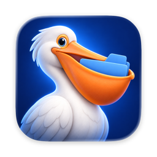

<p align="center">
  
</p>

<h1 align="center">Pelican</h1>

<p align="center">
  A friendly, native file transfer client for macOS.<br>
  SFTP, FTP and S3, in one window, for less than a coffee.
</p>

---

Pelican moves files between your Mac and your servers. It's built with SwiftUI, runs only on macOS, and will be sold once on the Mac App Store for $4.99. No subscription.

> **Status:** early development. SFTP, FTP, FTPS, Amazon S3 and Cloudflare R2 work: browsing, transfers and file operations.

## Features

| | Feature | Status |
|---|---|---|
| 🗂 | Dual-pane browser: this Mac on the left, the server on the right | Done |
| 🔐 | SFTP with password, passwords kept in Keychain, host key check, Test Connection | Done |
| 🔑 | SFTP with SSH key (ed25519; RSA on servers before OpenSSH 8.8) | Done |
| 📡 | FTP and FTPS (explicit TLS, encrypted data connections with TLS session reuse, certificate approval) | Done |
| ☁️ | Amazon S3, Cloudflare R2 and S3-compatible storage (SigV4, multipart uploads, server-side copy) | Done |
| ⭐️ | Saved servers | Done |
| ↕️ | Drag and drop transfers with a queue and progress | Done |
| 📁 | New folder, rename, move (drag), copy (⌥-drag), delete | Done |
| 📋 | Server Activity: transfers and a copyable log, from the toolbar | Done |
| 🌍 | English and Turkish | Done |
| ✏️ | Edit a remote file in your editor, upload on save | Planned |
| 🚀 | Publish: send only what changed from a local folder (e.g. to `public_html`), with excludes, preview, optional deletions and Cloudflare cache purge | Done |

## Requirements

- macOS 15 Sequoia or later
- Xcode 26 or later to build
- [XcodeGen](https://github.com/yonaskolb/XcodeGen)

## Building

The Xcode project is generated from `project.yml` and isn't checked in.

```sh
brew install xcodegen
xcodegen generate
open Pelican.xcodeproj
```

Make project changes in `project.yml`, then run `xcodegen generate` again.

To build and run sandboxed during development:

```sh
scripts/run-dev.sh
```

It signs with your Apple Development certificate (override with `PELICAN_SIGN_IDENTITY`). Use a real certificate, not ad-hoc signing: Keychain only returns saved passwords to the same signed app, and an ad-hoc signature changes on every build.

## Testing

The SFTP tests run against a throwaway server in Docker:

```sh
docker run -d --name pelican-sftp -p 2222:22 atmoz/sftp pelican:pelican-test:1001:100:upload
xcodebuild -scheme Pelican test
```

A second container runs a current OpenSSH, to check key sign-in against newer servers:

```sh
docker run -d --name pelican-sshd-modern -p 2223:2222 -e USER_NAME=pelican lscr.io/linuxserver/openssh-server
```

And Pure-FTPd for FTP and FTPS:

```sh
docker run -d --name pelican-ftp -p 2121:21 -p 30000-30009:30000-30009 \
  -e PUBLICHOST=127.0.0.1 -e FTP_USER_NAME=pelican -e FTP_USER_PASS=pelican-test \
  -e FTP_USER_HOME=/home/pelican -e "ADDED_FLAGS=--tls=1" -e TLS_CN=pelican-ftp.test \
  -e TLS_ORG=Pelican -e TLS_C=TR -e TLS_USE_DSAPRAM=true stilliard/pure-ftpd
```

And Versity Gateway for S3 (MinIO no longer publishes public images):

```sh
docker run -d --name pelican-s3 -p 9000:7070 -e ROOT_ACCESS_KEY_ID=pelican \
  -e ROOT_SECRET_ACCESS_KEY=pelican-test-secret versity/versitygw posix /tmp/vgw
```

When a server isn't running, its tests are skipped. `PublicServerTests` also use Rebex's public read-only demo (test.rebex.net), which is stricter than the containers: it needs a MAC in SSH key exchange and TLS session reuse on FTPS data connections. Run tests with a time limit so a hang can't stall the run:

```sh
xcodebuild -scheme Pelican test -test-timeouts-enabled YES -default-test-execution-time-allowance 120
```

### Known limit: RSA keys on newer servers

Citadel signs RSA keys with SHA-1 (`ssh-rsa`), which OpenSSH 8.8 and later refuse. RSA keys work on older servers; on newer ones Pelican explains the refusal and suggests an ed25519 key. `testModernServer` fails on purpose once this is fixed.

## Project layout

```
Pelican/
  App/         App entry point
  Model/       FileItem, Server, Favorites, Keychain, activity log, and the FileSource protocol
  Local/       This Mac: folder listing and sandbox folder access
  Remote/      RemoteSource protocol; SFTP (Citadel), FTP/FTPS (SwiftNIO), S3/R2 (URLSession + SigV4)
PelicanTLS/    TLS client on BoringSSL that resumes sessions across connections (FTPS data channels)
  Transfer/    Transfer queue, drag and drop, Server Activity popover
  Deploy/      Publish: site targets, change detection against the last publish, Cloudflare purge
  Views/       Window, pane and navigation state
  Resources/   App icon (Icon Composer), string catalog, Info.plist, entitlements
scripts/       Turkish translations and the script that fills the string catalog
PelicanTests/  Unit tests
design/        Icon and App Store artwork
```

Each pane shows a `FileSource`. This Mac, SFTP and S3 are separate implementations of the same protocol, so one pane view works for all of them.

## Translations

Pelican ships in English and Turkish. Strings live in `Pelican/Resources/Localizable.xcstrings`. After adding UI text:

```sh
xcodebuild -scheme Pelican build
xcrun xcstringstool sync Pelican/Resources/Localizable.xcstrings \
  --stringsdata $(find build -path "*Pelican.build/Objects-normal*" -name "*.stringsdata")
python3 scripts/apply_translations.py   # lists any string still missing Turkish
```

Add the missing Turkish to `scripts/translations_tr.json` and run the script again.

## Sandbox

Pelican runs in the App Sandbox, as the Mac App Store requires. On first launch it asks you to pick a folder it may browse; your home folder works best. That choice is saved as a security-scoped bookmark, so it's asked only once.

## Contact

Pelican is made by [Voxyfy](https://voxyfy.github.io). Questions and bug reports: haymana.batuhan@gmail.com

## License

Source available, **not open source**: © 2026 Batuhan Haymana, all rights reserved. You may read the code; you may not use, build, modify or distribute it without written permission. See [LICENSE](LICENSE). Third-party libraries keep their own MIT and Apache 2.0 licenses (listed in the app's About window; regenerate with `python3 scripts/make_credits.py`).
